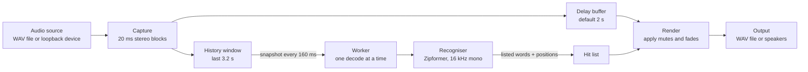

# Architecture

This describes the Rust program in `src/`.

## The idea in one paragraph

Audio is held in a short delay buffer before it is played. While it waits, a speech recogniser reads the most recent few seconds and reports any listed words with their positions. When a held block is finally released, any part that overlaps a reported word is faded to silence. The delay is what buys the recogniser time: a word can only be muted if it is recognised before its audio leaves the buffer.

## Data flow



Two things run at once:

- The audio path (capture → buffer → render) runs on the audio clock and never waits for recognition.
- The recognition path (history → worker → recogniser → hits) runs on its own thread and hands results back through a small queue.

## Files

| File | What it holds |
| --- | --- |
| `src/engine.rs` | Delay buffer, history window, worker, hit list, mute rendering, statistics, engine tests |
| `src/recognition.rs` | Word list loading, resampling, the Zipformer adapter, word matching |
| `src/main.rs` | Command line, WAV reading and writing, live audio devices, status reports |
| `words.txt` | The built-in word list |

## Parts in detail

### Audio format and blocks

Everything is stereo signed 16-bit PCM at 16, 32 or 48 kHz. Audio moves in 20 ms blocks (960 frames at 48 kHz). Positions are counted in frames since the start, so a word's position means the same thing to the recogniser and to the renderer.

### Delay buffer (`Engine::buffer`)

Every captured block is appended to a queue. A block is only released once the queue holds more than `delay / 20 ms` blocks, so output always trails input by the configured delay (`--delay-ms`, default 2000). Until the queue first fills, silence is played. The delay is fixed: slow recognition never makes the audio stall or stretch, it only makes a mute arrive late.

### History window (`Engine::history`)

The same blocks are also kept in a sliding window of the last 3.2 seconds (`--window-ms`). This is what the recogniser sees. It is longer than the delay on purpose: the recogniser is more accurate with context on both sides of a word.

### Scheduling checks (`Engine::capture`)

The first check is submitted once 1.04 s has been captured; after that, one every 160 ms (`--hop-ms`). A shorter interval finds words sooner at the cost of more CPU. Each check is a snapshot of the whole history window, tagged with the absolute frame range it covers.

### Worker (`Worker`)

One thread does all decoding. It holds at most one snapshot being decoded and one waiting. If a new snapshot arrives while one is already waiting, the waiting one is replaced and counted as `skipped_windows`. This keeps memory bounded and means that under load the recogniser always works on the freshest audio instead of falling further behind. Results go into a queue of 8; overflowing it is treated as a failure. If the recognition thread panics, that is also reported as a failure, so a crash can never turn into audio passing through unfiltered without anyone noticing.

### Recogniser (`Zipformer`)

- Downmix and resample: left and right are averaged, then low-pass filtered with an 81-tap windowed-sinc kernel (7.2 kHz cutoff) and decimated to 16 kHz.
- Model: the non-streaming GigaSpeech Zipformer transducer, run on CPU through sherpa-onnx with greedy search. GigaSpeech matters: models trained on audiobooks transcribe profanity as clean look-alike words.
- Timing: the model reports where each token starts. A token's end is taken as the next token's start, capped at 180 ms, since no true end time is available.

Only matched words and their positions leave this part. The transcript is never stored or printed.

### Word matching (`matched_words`)

The model emits word pieces, so one word may arrive split across several tokens. The pieces are joined into a single string with a start and end position remembered for every byte. Whole words (letters, optionally joined by apostrophes) are then picked out, lower-cased, and looked up in the word list. A match takes the earliest start and latest end of its bytes. Matching is exact: `ass` does not match `assume`, and each form of a word must be listed.

### Word list (`vocabulary`)

One English word per line, case-insensitive, `#` starts a comment. The default list is compiled into the program from `words.txt`; `--words FILE` replaces it at run time. A line that is not a single word is rejected with its line number.

### Turning results into hits (`Engine::apply`, `Engine::add_hit`)

Each result's word positions are converted from window-relative to absolute frames. Then:

- Edge exclusion: words within 120 ms of either end of the window are ignored, because a word cut off by the window edge is often misrecognised. The next overlapping window will see it whole. The final window of a file is allowed to use its trailing edge.
- Merging: overlapping windows report the same word several times with slightly different positions. A report that overlaps an existing hit for the same word is merged into it, widening the hit to cover both.
- Pruning: hits that lie entirely before both the oldest window and the playback position are dropped.

### Rendering the mute (`Engine::render`)

When a block is released, every hit is widened by a 400 ms lead-in and a 90 ms tail, with an 8 ms linear fade on each side to avoid clicks. Frames inside that range are scaled toward zero on both channels; frames outside are passed through unchanged. The lead-in is long because drawn-out words audibly begin well before the recogniser's first token timestamp.

### Deadlines and late hits

Each render call carries a deadline: the time that block is due. Only results that completed by that deadline are applied to it, even if a later result is already sitting in the queue. This keeps WAV mode honest: a file is processed at real-time pace and cannot use information a live run would not have had.

A hit is counted as late when some of the word itself had already been played before it was recognised, and fully late when all of it had. `max_late_core_ms` is the longest stretch of a word that escaped. A larger `--delay-ms` is the direct fix for late hits.

### WAV mode (`run_wav`, `pace_wav`)

Reads the input one block per 20 ms tick, feeds the engine, and writes each released block to a temporary file that is renamed over the output only on success. The output has exactly the same length and timeline as the input. The clock and the wait function are passed in, which lets the tests run the whole loop instantly with a fake clock.

### Live mode (`run_live`, `Live`)

Opens two audio streams through the `cpal` library: an input stream on a loopback device such as BlackHole 2ch, and an output stream on the real speakers. Both callbacks share one `Live` value behind a mutex.

- The input callback converts samples to 16-bit, re-cuts them into exact 20 ms blocks (the device delivers whatever chunk size it likes), feeds each block to the engine, and queues the block the engine releases.
- The output callback plays from that queue.

Two blocks of silence are queued at start so the output never finds the queue empty just because the two callbacks are out of step. `underrun_frames` counts output that had to be filled with silence and should stay at 0.

The two devices run on separate clocks. If the output device is the slower one, the queue slowly grows; once it holds 200 ms the oldest 20 ms block is dropped and counted in `drift_dropped_frames`. An Aggregate Device with drift correction (Audio MIDI Setup) avoids this entirely.

### Status reports (`report`)

One JSON object per line on stderr, every 2 seconds in live mode. The fields that matter most:

| Field | Meaning |
| --- | --- |
| `status` | `priming`, `running`, `degraded` (late hits or skipped windows), `complete`, `failed` |
| `hits` | Distinct words muted |
| `late_hits`, `fully_late_hits` | Words partly or wholly played before being recognised |
| `max_decode_ms` | Slowest single recognition check |
| `skipped_windows` | Checks dropped because the recogniser was busy |
| `max_hit_age_ms` | Longest gap between a word starting and being recognised |
| `input_peak` | Loudest input sample since the last report; 0 means silence is arriving |
| `underrun_frames` | Output frames filled with silence because none were ready |
| `drift_dropped_frames` | Frames dropped to keep the two audio devices in step |

### Tests

`cargo test` runs 13 tests. They use a hand-driven worker, so they are deterministic and need no model. They cover: audio is unchanged outside mutes and fades; WAV pacing never reads ahead or changes length; the history window stays bounded with absolute positions; a result that completes after a block's deadline cannot mute it; overlap merging and edge exclusion; repeated and duplicate late reports; a recogniser failure stops output before a block is lost; the worker replaces waiting snapshots without growing; a panic in recognition becomes an engine error; words split across tokens are matched whole; word list parsing; and option validation. They do not measure recognition accuracy on real speech or music.

## Timing budget

A word is fully muted only if it is recognised before its audio leaves the delay buffer. The time from a word starting to it being recognised is roughly:

```
word length + edge exclusion (120 ms) + wait for the next check (up to 160 ms)
  + decode time (typically 30-150 ms, occasionally several hundred under load)
  + however much following audio the recogniser needs before it settles on the word
```

That total must be under the delay for the word itself to be muted, and under the delay minus 400 ms for the whole lead-in to be muted too. The last line is the one the engine does not control: in live tests one word was only recognised about 2.5 seconds after it began. That is why some words are late at a 1 second delay and the default is 2 seconds.
